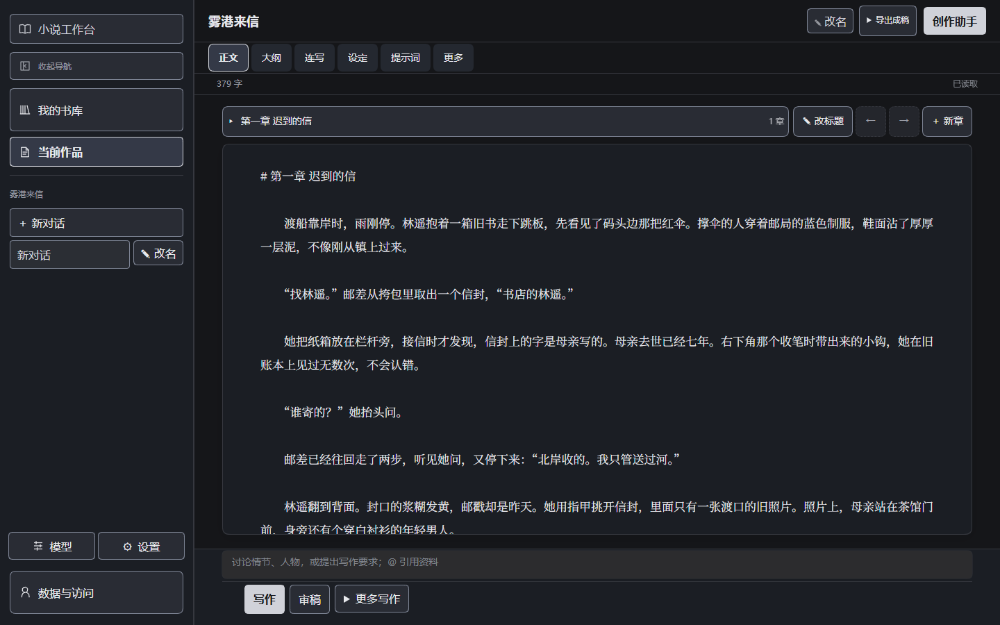
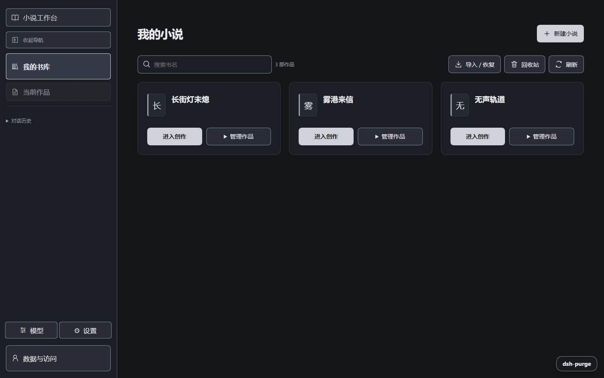
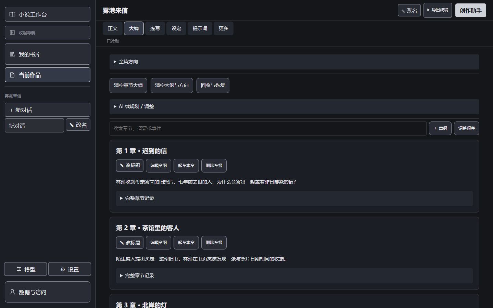
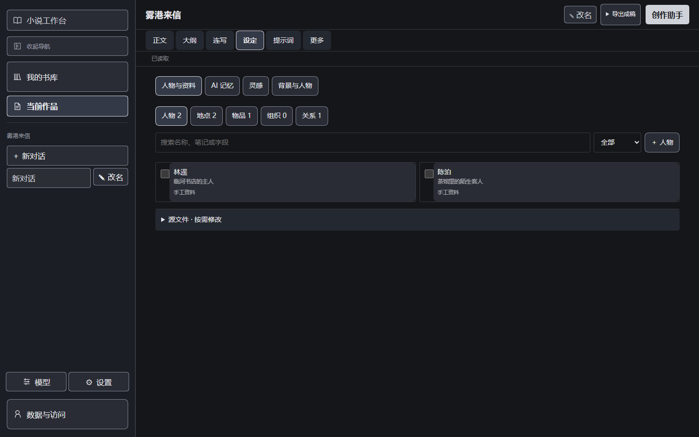
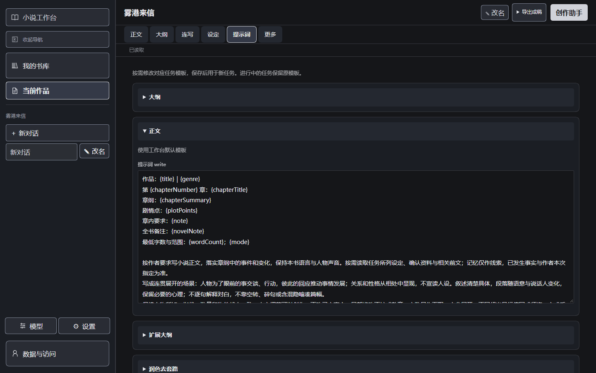
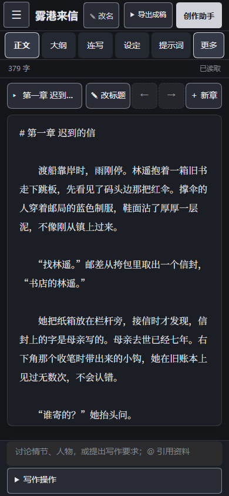
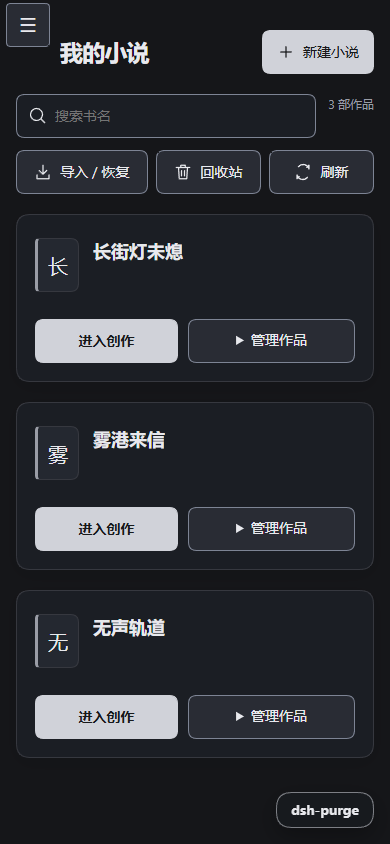
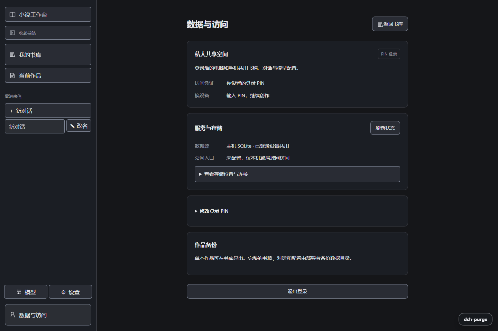
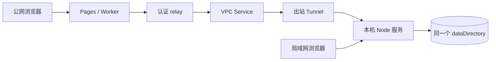

# NovelHarness

[](https://github.com/BorderArea01/NovelHarness/actions/workflows/ci.yml)


**看图取材，装插件扩展，用对话持续打磨一本小说。**

基于 DeepSeek Harness 的开源小说 Agent：图片可以成为创作参考，兼容插件可以扩展助手的工作方式，对话中的修改可以直接写回大纲和正文。

| 看得见你的参考图                                                       | 接得上 DSH 插件                                                  | 改得动整本书稿                                                       |
| ---------------------------------------------------------------------- | ---------------------------------------------------------------- | -------------------------------------------------------------------- |
| 上传图片，讨论角色神态、场景细节与情节灵感；需使用支持图片输入的模型。 | 沿用原生插件机制，已集成 dsh-purge；由部署者安装、配置兼容插件。 | 查前文、补章纲、续写和改写可以交错进行，实际修改写回作品并保留历史。 |

面向使用 DeepSeek API、希望长期维护作品，并自己掌握数据、提示词和运行方式的作者。从零碎灵感开始，边讨论边补齐资料；也可以接着已有书稿持续修改，作者随时接手编辑。

> **你可以这样交代任务：**
> “读一下前两章，把林遥的怀疑提前埋进第一章；第二章对应的对白也改一下，结局先保留。”
>
> 读哪些章节、改大纲还是改正文，都围绕当前要求展开；你可以在书稿里检查实际修改，继续提出下一轮想法。

| 创作时真正费力的事                             | NovelHarness 的做法                                                    |
| ---------------------------------------------- | ---------------------------------------------------------------------- |
| 聊了很多轮，还要把结果逐段搬回稿子             | 对话连接书稿读写工具，修改可以直接写回作品，并保留历史                 |
| 改一个情节，需要在正文、大纲和设定之间来回调整 | 同一次对话可以组合查阅、起草、续写与改写，由任务决定使用哪些工具       |
| 聊天越积越杂，重开后又得重新介绍整本书         | 可以清空当前聊天，保留同一本书的正文、大纲和资料，供新对话继续查阅     |
| 手里有参考图，只能先把画面重新描述一遍         | 使用识图模型，让助手结合图片讨论外貌、神态、空间关系与情节，再写入故事 |
| 想改变 AI 的工作方式，界面里的参数不够用       | 常用任务提示词在前端编辑；进一步的工具与运行逻辑可以修改源码和插件配置 |



[与其他用法的区别](#与其他用法的区别) · [图片取材与插件扩展](#图片取材与插件扩展) · [界面预览](#界面预览) · [快速开始](#快速开始) · [部署](#部署) · [数据与备份](#数据与备份)

## 与其他用法的区别

相较于主要在聊天框输出小说的用法，这里的重点是**让讨论产生可继续维护的书稿改动**；相较于按“大纲 → 章节”按钮推进的用法，这里的重点是**通过同一个助手处理反复、交错的修改要求**。

**图片理解和 DSH 插件扩展，也是本项目区别于普通 API 写作接入的两个重点。** 图片能进入创作讨论，助手的能力也能随兼容插件扩展；再与可执行的长对话、持续保存的作品资料和开源自托管结合，形成可以长期使用的创作环境。

它适合愿意掌握创作环境、长期迭代一部作品的人。希望免部署、直接使用托管服务，或只需一次生成初稿的作者，也可以选择更贴合自己习惯的产品。

<details>
<summary>客观比较：哪些能力并非独有，哪些效果还不能承诺？</summary>

成熟产品也在持续进步。[Sudowrite Chat](https://feedback.sudowrite.com/help/articles/1016913-chat) 已支持在对话中修改项目文档和故事资料；Novelcrafter 提供 [Codex 资料库](https://www.novelcrafter.com/features/codex)、[自定义提示词](https://www.novelcrafter.com/help/docs/prompts/prompt-types) 和 [自备 API Key](https://www.novelcrafter.com/help/reference/terms/novelcrafter)。因此，大纲、人物资料、聊天、自定义提示词或自带 Key，都不应单独被宣传为本项目独有的优势。

本项目没有足够的对比证据证明文笔、长篇一致性或复杂改稿成功率高于这些产品。模型依然可能遗漏设定、误读要求或写出不理想的内容，需要作者判断与审稿。书内资料可持续保存，不等于模型每次都会读完、理解正确或永不遗忘。

自托管意味着书稿和对话由部署主机保存；调用模型 API 时，请求中使用的内容仍会发送给模型服务商。部署与 API 也有各自的成本，开源不等于零成本或无限生成。

</details>

## 图片取材与插件扩展


两张彩色横幅均为概念宣传插画，使用书页、场景与工具模块表达创作；实际软件界面见下方截图。插画的生成不代表工作台提供绘图功能。[插画设计与生成说明](docs/images/PROMO.md)。

**章节插图**：在正文点「插图」，填写可选图注并选图，插在光标所在段落之后，再随正文保存。支持 PNG、JPEG、WebP，上传时自动缩小并压缩；桌面预览限高 140px、手机 104px，可收起或点开放大。可以复用本书图片、改图注、更换和移除；也能让助手通过 `novel_illustration` 安排已上传插图的位置，原章节保留版本历史。完整书籍备份保留插图，HTML 和 Markdown 成稿内嵌图片，TXT 只保留图注。不提供 AI 绘图。

### 把参考图带进对话

在助手输入区添加图片，也可以拖入或粘贴图片，再直接提出创作要求。例如：

> “参考这张图的光线和空间布局，写一段主角抵达港口的场景；把图上可见的细节和你补充的情节分开说明。”
>
> “看这张角色图的外貌、神态和动作，讨论他此刻可能经历了什么，再把选定的方向写进下一章。”

图片随对话保存，历史中可打开原图，继续围绕同一份参考讨论。识图依赖所选模型与 API 端点的图片能力；**上传成功不代表当前模型能够看图**。纯文本模型仍只能处理文字，图片中的身份、动机与遭遇也可能只是推测，需要作者判断。

### 用兼容插件扩展助手

沿用原生 DSH 的插件组合包与配置机制，已集成 **dsh-purge**。部署者可安装、启停和配置兼容插件，进一步调整助手的工作方式；常用写作任务提示词也能直接在工作台中修改。

插件的安装与宿主更新由部署者维护，访客只能管理获准开放的个人配置，不能随意改动共享宿主。不同插件对 DSH 版本、主机环境和工具权限有各自要求，安装成功也需要验证能否正常运行。现有站点对重启、卸载、宿主补丁等管理操作保留保护。

## 界面预览

截图使用独立的虚构小说数据，不含真实用户书稿、对话、API Key 或主机路径。点击图片可查看原图。

| 我的书库                                                             | 章节大纲                                                               |
| -------------------------------------------------------------------- | ---------------------------------------------------------------------- |
|  |  |
| 多本小说分别保存，随时回到当前作品。                                 | 大纲与正文放在同一本书中，支持手动编辑。                               |

| 小说设定                                                                 | 提示词管理                                                               |
| ------------------------------------------------------------------------ | ------------------------------------------------------------------------ |
|  |  |
| 自由文本、资料与对话一起服务于当前故事。                                 | 按需调整提示词，不必翻找源代码。                                         |

### 手机也能继续写

<p>
  
  
</p>

宽屏可拖动书稿与助手之间的分隔线，记住当前浏览器的宽度偏好；双击恢复默认，方向键微调。窄屏使用单页切换，导航展开为遮罩抽屉，正文和对话各自保持可读空间。

### 数据与访问



私人模式可以修改 PIN、查看实际存储位置和入口配置；访客模式显示自己的访问凭证与备份范围。存储位置默认折叠，查看部署信息需要登录。

## 快速开始

需要 **Node.js 24 LTS** 和 npm，支持 Windows、Linux。按顺序执行：

```sh
git clone https://github.com/BorderArea01/NovelHarness.git
cd NovelHarness
npm ci
npm --prefix cloud/tools ci --ignore-scripts --no-audit --no-fund
npm run build
npm start
```

打开 [http://127.0.0.1:3210](http://127.0.0.1:3210)，默认使用免 PIN 的访客隔离模式。

1. 在侧栏「模型」中配置自己的 DeepSeek API Key。
2. 新建小说，或从书库导入已有作品。
3. 打开「创作助手」提出想法，结合大纲、正文和设定持续创作。

AI 可以调用工具更新正式书稿，修改保留历史与并发冲突检查。没有 API Key 时仍可手动编辑；新空间首次启动原生宿主会稍慢。

## 部署

### 选择模式

**同一套程序、同一次构建，通过配置选择数据边界。** 访客不能在网页中切换整站模式。

| 模式               | 登录                  | 数据范围                           | 换设备             |
| ------------------ | --------------------- | ---------------------------------- | ------------------ |
| `isolated`（默认） | 浏览器 Cookie，免 PIN | 每位访客独立的书稿、对话、API 配置 | 默认进入新空间     |
| `shared`           | 部署者设置的 PIN      | 已登录设备共用一个私人空间         | 输入 PIN，继续创作 |

两种模式都需要服务器存储。访客隔离不是“没有数据库”或“只存浏览器”：浏览器 Cookie 识别自己的服务器空间，每个访客都有独立的 SQLite 与原生对话目录。

访客模式不继承部署者的 API Key。清除 Cookie、换浏览器或换设备会进入新空间，没有 PIN 找回功能。请保留浏览器网站数据并定期导出作品。部署者仍可管理主机数据，这不是端到端加密。

### 配置文件

默认读取项目根目录的 `novelharness.config.json`，该文件不会提交 Git。环境变量可以覆盖其中的值。

| 示例                                                  | 用途                                  |
| ----------------------------------------------------- | ------------------------------------- |
| [访客模式](novelharness.config.example.json)          | 默认免 PIN、访客数据隔离              |
| [私人局域网](novelharness.config.shared.example.json) | PIN 登录，电脑和手机共用数据          |
| [私人公网](novelharness.config.public.example.json)   | 声明现有 Cloudflare VPC / Tunnel 入口 |

私人局域网部署可复制第二份示例并保存为 `novelharness.config.json`：

```json
{
  "mode": "shared",
  "host": "0.0.0.0",
  "port": 3210,
  "ingress": "lan",
  "dataDirectory": "./data/private-writing-space"
}
```

然后检查配置并启动：

```sh
npm run deployment:check
npm start
```

首次交互式启动会在终端提示设置 PIN，输入隐藏。无人值守环境通过 `NOVEL_INITIAL_PIN` 完成首次初始化。已有 PIN 不会被这个变量重设，以后在「数据与访问」中修改。不要把 PIN 或 API Key 写进配置 JSON。

局域网设备使用 `http://主机IP:3210`。`127.0.0.1` 只监听本机，`0.0.0.0` 允许通过主机网络地址访问。HTTP 适用于可信局域网，公网入口使用 HTTPS。

### 数据源与持久磁盘

程序使用 **本机 SQLite**，不需要另配 MySQL、PostgreSQL、Cloudflare 数据库，也没有数据库账号密码或任意数据库 URL 设置。

`dataDirectory` 指定实际数据目录。相对路径按启动时的项目工作目录解析，服务器建议使用固定的绝对路径。容器部署者需要把持久卷挂载到这个路径；仅保存镜像或程序文件不等于保存了数据。

| 模式       | `dataDirectory` 内的数据                                                            |
| ---------- | ----------------------------------------------------------------------------------- |
| `isolated` | 每个访客自己的子目录，包含 `main.sqlite`、`home/`；根目录还有访客签名密钥与模式登记 |
| `shared`   | 一份 `main.sqlite`、`home/`、`owner-key.txt`、模式登记与会话锁                      |

私人空间的主要文件：

```text
private-writing-space/
├─ main.sqlite          # 书稿、大纲、设定、历史等虚拟文件
├─ home/
│  ├─ sessions/         # 原生长对话
│  └─ …                 # 模型凭据、配置、附件、PIN 与插件个人配置
├─ owner-key.txt        # 主机恢复口令，妥善保管
└─ …                     # 模式登记与服务锁
```

恢复口令只在忘记 PIN 时使用，不需要填写到模型设置。改错数据目录可能打开另一份空空间；**修改配置不会搬迁、合并或导入旧小说**。模式登记与进程锁会拒绝错误模式或第二个写入者，但仍需部署者核对实际路径。

### 公网与穿透

`publicOrigin` 声明浏览器访问的公网来源，**不会自动建立代理、隧道或 Cloudflare 绑定**。`ingress` 用于明确连接方式：

| `ingress`        | 场景                                 | 还需要部署什么                                                  |
| ---------------- | ------------------------------------ | --------------------------------------------------------------- |
| `lan`            | 本机或局域网访问                     | 正确的监听地址和端口，不填 `publicOrigin`                       |
| `reverse-proxy`  | 自建服务器或已有 HTTPS 代理          | HTTPS 代理、域名 / 路由、`publicOrigin`                         |
| `cloudflare-vpc` | 私人模式通过 Pages / Worker 访问本机 | 出站 Tunnel、VPC Service、Worker 绑定、转发密钥、`publicOrigin` |

普通反向代理必须保留外部 Host，透传 WebSocket、SSE / 流式响应和 Cookie；用户 API 不应缓存或缓冲，并需为长时间生成设置合适的请求超时。

私人 Cloudflare 部署的链路：



现有 [relay 实现](cloud/host/relay-worker.mjs) 需要以下服务端绑定：

| 绑定                  | 内容                                                          |
| --------------------- | ------------------------------------------------------------- |
| `LOCAL_SERVICE`       | 指向实际 Node 地址和端口的 VPC Service                        |
| `NOVEL_PUBLIC_ORIGIN` | 与本机 `publicOrigin` 一致的 HTTPS 来源                       |
| `DSH_EDGE_ACCESS_KEY` | 与私人数据目录的 `owner-key.txt` 一致，作为服务端 secret 保存 |

转发密钥不能发送到浏览器或提交 Git。relay 会覆盖客户端提供的转发头，本机再核验密钥与来源。VPC 的实际目标由 Service 配置决定，不能靠改请求里的网址选择另一台主机。

创建服务、绑定权限和 Tunnel 连接条件见 [Cloudflare VPC Services](https://developers.cloudflare.com/workers-vpc/configuration/vpc-services/) 与 [Tunnel 文档](https://developers.cloudflare.com/workers-vpc/configuration/tunnel/)。仓库旧私人迁移脚本依赖部署者自己的记录，不是新账号的一键部署工具。

**Cloudflare Pages 或 GitHub Pages 不能单独运行这个 Node 服务。** 数据仍在 Node 主机，主机关机或断网时公网暂不可用；不能自动切到旧云端数据。程序不会自动修改 DNS、路由、防火墙或现有网络设施。

### 环境变量与启动

| 变量                  | 默认值                     | 含义                                       |
| --------------------- | -------------------------- | ------------------------------------------ |
| `NOVEL_MODE`          | `isolated`                 | `isolated` / `shared`                      |
| `HOST`                | `127.0.0.1`                | 监听地址                                   |
| `PORT`                | `3210`                     | 监听端口                                   |
| `NOVEL_CONFIG`        | `novelharness.config.json` | 部署配置文件路径                           |
| `NOVEL_DATA_DIR`      | 按模式选择的默认目录       | 覆盖 `dataDirectory`                       |
| `NOVEL_RUNTIME_DIR`   | `data/anonymous-runtime`   | 构建与程序安装目录，与数据目录的用途不同   |
| `PUBLIC_ORIGIN`       | 未配置                     | 公网 HTTP(S) 来源，不带路径、凭证或查询    |
| `NOVEL_INGRESS`       | 无公网地址时 `lan`         | `lan` / `reverse-proxy` / `cloudflare-vpc` |
| `NOVEL_INITIAL_PIN`   | 无                         | 仅用于私人模式首次初始化                   |
| `MAX_ACTIVE_VISITORS` | `2`                        | 驻留访客宿主数，范围 1–8，按内存调整       |

Windows 后台启动和开机启动也读取同一份部署配置：

```sh
npm run start:background
npm run autostart:install
# 移除开机启动
npm run autostart:remove
```

首次 PIN 初始化先通过交互式 `npm start` 完成。后台启动不自动构建，也不会停止占用端口的其他服务。

一个构建可供多个实例使用，但实例必须使用不同的数据目录与端口。所有使用某份构建的实例停稳后，才能原地重建它。驻留空间都忙时，新访客会收到稍后重试的提示；运行中的 AI 不因空间切换而被强行停止。

访客宿主 V8 堆上限为 384 MiB，私人宿主为 512 MiB，另有原生内存开销。本版适合小规模部署，尚未完成高并发和长期内存稳定性验证。

## 数据与备份

### 备份完整空间

先等 AI 完成、停稳服务，再备份整个数据目录。

- 访客模式必须保留 `visitor-secret.json`，否则原浏览器 Cookie 无法继续识别空间。
- 私人模式必须保留 `main.sqlite`、完整 `home/`、`owner-key.txt` 和模式登记文件。
- 单本小说导出适合保存作品或跨空间导入，**不包含全部原生对话和全局模型配置**。

默认构建目录沿用 `data/anonymous-runtime/`。未显式指定数据目录时，空间也可能位于其内部的 `visitors/` 或 `shared/` 目录；删除程序目录前必须检查数据位置。旧访客签名密钥首次升级时会原样保留到默认数据目录，原文件也保留。

建议把完整备份恢复到独立验证目录，核对书稿、对话、附件、PIN 和模型配置后再使用。不要在两个正在写入的实例之间复制 SQLite 实现同步。代码回退时也应继续使用最新数据，不能把小说一起退回旧备份。

### 升级与旧库接管

1. 等待 AI 完成，停稳服务并备份完整数据目录。
2. 拉取源码，按锁文件安装依赖，运行 `npm run build`。
3. 保留原来的部署配置与数据目录，运行 `npm start`。
4. 从局域网和公网分别核验登录、同一本书的读取与保存、原生连接和流式输出，再验证重启后的内容。

升级到另一份已准备好的构建时，程序只重新绑定有归属记录的托管依赖，不改写用户资料或个人插件配置。构建不会读取其他正式 / 隔离站数据库，也不会自动合并书库。

<details>
<summary>已有旧私人安装包：停机核验与原目录登记</summary>

先只读检查原目录：

```sh
node cloud/selfhost/adopt-store.mjs --legacy-runtime=/path/to/old-runtime --runtime-directory=/path/to/prepared-runtime --data-directory=/path/to/old-runtime/data/official-validation/integration/formal-promotion
```

核验、备份并停稳旧服务后，加 `--apply` 执行登记。SQLite、对话、图片、PIN 与恢复口令仍留在原路径；工具拒绝旧进程仍运行时登记，并保留恢复托管依赖的记录。随后把 `mode` 设为 `shared`，`dataDirectory` 指向这个原目录。

准备副本不等于正式切换。不要拿早期旧库、空目录或书稿 JSON 替换最新原生数据。

</details>

### 检查真实状态

`npm run deployment:check` 只读检查实际数据路径、目录模式、SQLite 完整性、PIN 初始化和入口配置，不创建数据库或改网络。

`configurationValid` 仅表示没有检查到配置错误。warning 和 `publicConnectionVerified: false` 不能当成公网验收成功；需要实际从外网检查连接。私人页面「数据与访问 → 服务与存储」也可查看运行中的真实位置，未登录者和访客不能取得主机路径。

## 开发与验证

```sh
npm run test:public
npm run test:public:integration
```

集成测试使用独立空间和演示小说，不调用付费模型。完整协议和浏览器验收：

```sh
npm --prefix cloud/official ci --ignore-scripts --no-audit --no-fund
node --max-old-space-size=128 cloud/tests/run.mjs
npx playwright install chromium
npm run test:public:browser
```

维护者可以在已有构建上重新生成本文截图：

```sh
node --max-old-space-size=96 scripts/capture-readme.mjs
```

截图脚本创建临时私人演示空间，拦截模型请求，完成后删除演示数据；不会打开现有书库。可通过 `NOVEL_RUNTIME_DIR` 指定已准备的构建，通过 `PLAYWRIGHT_EXECUTABLE_PATH` 指定本机浏览器。

## 许可证

[GPL-3.0-only](LICENSE)。上游依赖保留各自许可证，见 [THIRD_PARTY_NOTICES.md](THIRD_PARTY_NOTICES.md)。不内置 API Key、小说或对话。
